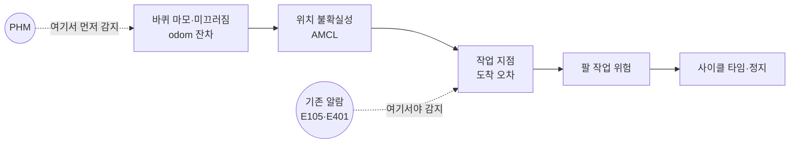

# robot-field-toolkit
**MoMa(Mobile Manipulator)를 위한 PHM(예지 정비) 툴킷** — ROS 2 Jazzy · Gazebo Harmonic · Nav2

> 자율화된 환경에서는 작은 오차가 연쇄적인 운영 리스크로 증폭된다. 그래서 PHM 시스템을 도입한다.

바퀴가 0.5mm 닳으면 odom이 1% 더 갔다고 믿습니다. AMCL이 LiDAR로 위치를 계속 고쳐 주기 때문에 Nav2는 "도착 성공"이라고 하고, 기존 알람(바퀴 헛돎 E105, 도착 오차 E401)도 조용합니다. 그 사이 위치 불확실성이 커지고, 도착 오차가 커지면 팔 작업이 빗나갑니다.
이 툴킷은 **사이클마다 건강지표를 재고, 같은 조건의 기준선과 통계로 비교해서, 연쇄의 첫 고리(odom 잔차)에서 먼저 경보를 내고 운용을 안전 쪽으로 바꿉니다.**



## 핵심 결과: 시나리오 A 바퀴 마모 (Gazebo)
실제 바퀴 반지름만 단계적으로 줄이고 odom 계산은 원래 반지름을 쓰게 했습니다. **메시지 조작(고장 주입) 없이 물리 조건만 바꿨습니다.** 단계마다 4사이클(A ↔ B 10.2m 주행 + 팔 4자세).

| 바퀴 마모 | 실제 반지름 | 회전 비율 IMU/odom (예상) | 이동 잔차 (예상) | PHM | 기존 알람 E105 / E401 |
|---|---|---|---|---|---|
| 0% (기준선) | 50.0mm | 1.149 | 2.57% | 정상 | 0 / 0 |
| 1% | 49.5mm | 1.137 (1.138) | 3.59% (3.6) | 정상 | 0 / 0 |
| 2% | 49.0mm | 1.126 (1.126) | 4.17% (4.6) | 정상 (이동평균 d 1.97, 기준 2 바로 아래) | 0 / 0 |
| 3% | 48.5mm | 1.110 (1.115) | 4.97% (5.2) | **주의** (3사이클째, 회전 비율) | 0 / 0 |
| 4% | 48.0mm | 1.115 (1.103)* | 5.91% (6.7) | 1사이클째 주의 → 3사이클째 **경고** → 자동 대응 | 0 / 0 |

- 지표는 물리 계산으로 예상한 값대로 움직였습니다. 반지름 0.5mm(1%) 차이가 이동 잔차 +1%p로 나타납니다.
- **PHM은 마모 3%(15번째 사이클)에서 주의, 4%(18번째)에서 경고를 냈고, 끝(19사이클)까지 기존 알람 E105·E401은 한 번도 뜨지 않았습니다.** 기존 알람만 있었다면 이 열화는 보이지 않았습니다.
- 자동 대응: 주의에서 속도 70%, 경고에서 속도 50% + 팔 정밀 작업 보류 + 재캘리브레이션 권고가 실제로 적용됐습니다. 대가로 사이클 타임이 51s → 72s → 95s로 늘었습니다 (안전과 생산성의 맞교환).
- \* 4%는 1사이클째 주의로 속도가 70%·50%로 내려간 상태에서 잰 값이 섞여 있습니다. 속도 100%였던 1사이클째 회전 비율은 1.091로 예상(1.103)에 가깝고, 느려진 뒤에는 1.118~1.131로 올라갔습니다 (속도 변화가 지표에 섞임). 6% 단계는 이 혼입과 LiDAR 기울어짐 때문에 실행하지 않았습니다.
- 정비 리포트: [A 마모](docs/report_wear_A.md) · [C 하중](docs/report_load_C.md) · [B·D](docs/report_env_DB.md), 원자료 `docs/*.csv`
- 실제 도착 오차는 Gazebo 실제 위치(ground truth)로 따로 채점했고, 감지에는 쓰지 않았습니다.

## 다른 조건 변화 시나리오 (Gazebo, 모두 메시지 조작 없음)
| 시나리오 | 만든 방법 | 결과 | 의미 |
|---|---|---|---|
| **C 실제 하중** | 팔 끝에 0.5kg (`payload_kg:=0.5`) | 팔 도달 시간 4.4s → 10.5s. 하중별 기준선으로 학습 8 → 정상 4, **경보 0**. 같은 데이터를 빈 상태 기준선 하나로 판정하면 7사이클째 **거짓 경고** | 짐을 든 정상 운용을 고장으로 오판하지 않으려면 하중별 기준선이 필요 |
| **B 저마찰 바닥** | A 지점에 마찰 0.05 판 (바퀴 1.5) | 판 위에서 돌아 출발하는 사이클마다 회전 비율 1.149 → 1.03 (약 −10%), 4사이클째 **주의**†. **E105는 안 뜸** | 회전 미끄러짐은 직진 헛돎만 보는 E105의 빈틈 → IMU 회전 비율이 메움 |
| **D 지도에 없는 장애물** | 경로 위에 3m 벽 | 처음엔 Nav2가 벽에 박음 → 원인은 costmap `max_obstacle_height` 기본값 0.0 (LiDAR 점 전부 버림, 11/21 충돌의 진짜 원인). 수정 후 회피 5/5. 그런데 돌아가는 사이클은 이동 잔차가 2.6% → 7%로 커져 **주의** | 이동 잔차는 길 모양에 따라 바뀜 → 경로 변경을 열화로 오판할 수 있는 **한계**. 경로별 기준선이 다음 과제 |
| 팔 상태별 풋프린트 | 팔이 펼쳐지거나 짐을 들면 costmap 풋프린트 확대 (`arm_footprint`) | rviz2에서 외곽선이 원 → 사각형으로 바뀜 확인 | E301(펼친 채 주행 위험)과 같은 이유 |

† B의 주의에는 바로 앞에 실행한 D(벽 충돌, 회전 비율 0.28) 사이클의 이동평균 이력이 섞였습니다. D 사이클을 빼고 오프라인으로 다시 판정하면 4사이클째 이동평균 d는 3.2지만 연속 횟수가 모자라 아직 정상입니다. 회전 비율이 10% 떨어진 것은 이력과 무관한 측정값입니다. D 재시험(D2)의 1~2사이클 경고·주의도 앞 B의 이력이 남은 탓입니다 (시나리오 사이에 이력을 비우지 않은 실수).

갑작스러운 사고(벽 충돌의 바퀴 헛돎)는 기존 알람 E105가 잡았고, 서서히 진행되는 열화(바퀴 마모)는 PHM이 먼저 잡았습니다. 둘은 역할이 다릅니다.

## PHM 구성
| 단계 | 내용 | 파일 |
|---|---|---|
| 측정 | 사이클 1회마다 건강지표 8종: ① 회전 잔차(IMU vs odom) ② 이동 잔차(odom vs 지도 위치) ③ 구동 추종률 ④ AMCL 불확실성 ⑤ 도착 오차 ⑥ 팔 도달 시간 ⑦ LiDAR 유효 비율 ⑧ 토픽 주기·지터·지연 | `core/health_indicators.py` |
| 기준선 | **하중 상태별**로 정상 8사이클의 평균·표준편차. 짐을 실어 바뀐 것은 열화가 아니므로 같은 하중끼리만 비교, 처음 보는 하중은 "기준선 학습 중" | `core/phm.py` |
| 건강도 | 이탈 d = (값 − 평균) / max(표준편차, 최소 표준편차), 나쁜 방향만. 지표 점수 100 − 20·(d − 1), 건강도 = (평균 + 최저) / 2 | `core/phm.py` |
| 예지 경보 | 최근 5사이클 이동평균의 d가 2(주의)·3(경고)을 **3사이클 연속** 넘을 때만. 한 번 튄 값은 점수에는 보이지만 경보는 안 냄 | `core/phm.py` |
| 자동 대응 | 주의 → 속도 70%, 경고 → 속도 50% + 팔 정밀 작업 보류 + 재캘리브레이션 권고 | `core/phm_response.py` |
| 정비 리포트 | **러너가 끝날 때 자동으로** CSV 옆에 Markdown 생성: 어떤 지표가, 언제부터, 얼마나, 추세선으로 남은 사이클, 권고 우선순위 (`phm_report` 명령으로 다시 만들 수도 있음) | `core/phm_report.py` |
| 러너 | A ↔ B MoMa 사이클 반복, 사이클마다 CSV 한 줄, 기준선 재설정 서비스 | `nodes/health_runner.py` |

**설계 원칙**
- 고장 주입 대신 **조건 변화**(바퀴 마모)로 열화를 만든다.
- **ground truth는 채점용으로만** 쓴다 (CSV 별도 열).
- **통계만** 쓴다 (평균, 표준편차, 이동평균, 추세선). 머신러닝은 쓰지 않는다.
- 판정 로직(`core/`)은 rclpy 없는 순수 파이썬이라 pytest로 검증하고, ROS 밖에서도 재사용할 수 있다.

## 시행착오에서 배운 것 (자세한 기록: [docs/DEVLOG.md](docs/DEVLOG.md))
| # | 증상 | 원인 → 조치 | 배운 것 |
|---|---|---|---|
| 23 | 지도에 없는 벽에 Nav2가 계속 박음 (11/21부터) | 정지 시험으로 "LiDAR 점은 보이는데 costmap엔 안 칠해짐" 확인 → 파라미터를 직접 꺼내 보니 `max_obstacle_height: 0.0` (Jazzy 기본값) → 2.0 | 11/21엔 로봇 반지름을 늘려 증상만 덮었음. 원인은 다른 층에 있었다 |
| 15·16 | Nav2는 "도착 성공"인데 매 사이클 E401 | Nav2 도착 기준 25cm ↔ E401 10cm 모순 → 5cm로. 그래도 ground truth로 보니 실제로는 4.6cm에 섰는데 AMCL이 13cm 틀리게 믿음 | 작업 알람 기준이 측위 정밀도보다 좁으면 알람이 잡음을 잰다. 측위 품질을 따로 감시해야 함 |
| 17 | 주행 중 Nav2가 목표를 중단 | BT가 컨트롤러 응답을 20ms 안에 못 받음 (WSL 통신 지연) → 100ms | 로그 시각 대조로 원인 특정 |
| 18 | 정상 주행에서 E403(경로 차단)이 24/24 사이클 | 로그 시각 대조: 매번 출발 후 15.0초 = 판정 창. 진척 기준점이 "남은 거리 0" 피드백에 고정되는 버그 → 수정 후 0/4 | 알람 시험은 "뜨는지"와 "정상에서 안 뜨는지" 둘 다 |
| 20 | 마모 0%인데 건강도 40 | ⑧ 타이밍 지표: /imu 간격 10ms → 5ms. 재스폰한 로봇의 IMU가 중복 발행 → 전체 재시작 방식으로 | 건강도가 갑자기 떨어지면 "열화"인지 "측정 경로 이상"인지 타이밍 지표부터 |
| 22 | 첫 예지 경보 순간 러너가 죽음 | rclpy 로거가 같은 줄에서 심각도를 바꾸면 예외 → 같은 패턴의 AlarmReporter도 수정 | 정상일 때 안 도는 코드 경로는 경보가 처음 뜰 때 터진다 |

## 기존 알람 (1·2층)
현장 알람 매뉴얼처럼 **코드 → 의미 → 원인 → 점검 순서(돈·시간 안 드는 것부터)** 로 안내합니다. 전체: [config/alarm_codes.yaml](robot_field_toolkit/config/alarm_codes.yaml).
등급은 두산 협동로봇 정지 방식: WARN(기록) / ALARM(Soft Stop) / EMERGENCY(Quick Stop).

| 코드 | 이름 | 판정 기준 |
|---|---|---|
| E101~E104 | 구동 정지·출력 저하·명령 손실·방향 이탈 | 명령(/cmd_vel_checked) 대비 실제 속도 |
| E105 | 바퀴 헛돎 | odom은 2초 15cm 이동인데 LiDAR 스캔 변화 3cm 미만 (Nav2 거짓 성공 대비) |
| E201·E202 | LiDAR 가림·끊김 | 유효 거리값 60% 미만 / 5Hz 미만 |
| E301~E303 | 팔 펼침 중 주행 차단·주행 중 팔 요청 거부·팔 도달 시간 초과 | 주행·팔 인터락 |
| E401~E403 | 도착 오차 초과(팔 작업 금지)·위치 상실·경로 차단 | TF 도착 오차 10cm, AMCL 표준편차 0.35m, 15초 진척 없음 |

## 실행
터미널마다 `source ~/field_toolkit_ws/install/setup.bash` 후 실행합니다. 공통 순서: Gazebo → 툴킷 → Nav2 → (rviz2) → 러너.
```bash
ros2 launch my_robot_gazebo gazebo.launch.py          # 조건 인자: wheel_wear:=0.03 (A 바퀴 마모 3%), payload_kg:=0.5 (C 팔 끝 하중)
ros2 launch robot_field_toolkit toolkit_base.launch.py # 감시·인터락·풋프린트
ros2 launch my_robot_navigation navigation.launch.py   # Nav2
```
시나리오별 한 줄 (러너가 끝나면 `~/field_toolkit_reports/<csv>_report.md` 정비 리포트가 자동으로 생김):
```bash
# A 바퀴 마모: Gazebo를 wheel_wear:=0.03 으로 켠 뒤
ros2 launch robot_field_toolkit health_check.launch.py cycles:=4 csv_name:=wear_A.csv condition:=wheel_wear=0.03
# C 하중: Gazebo를 payload_kg:=0.5 로 켠 뒤
ros2 launch robot_field_toolkit health_check.launch.py cycles:=12 load_state:=loaded_0.5kg csv_name:=load_C.csv condition:=payload_kg=0.5
# B 저마찰 바닥: A 지점에 판을 깔고 실행
ros2 run ros_gz_sim create -world simple_room -name slippery_B -file $(ros2 pkg prefix robot_field_toolkit)/share/robot_field_toolkit/test_assets/slippery_patch.sdf -x 4.02 -y -3.69 -z 0.001
ros2 launch robot_field_toolkit health_check.launch.py cycles:=4 csv_name:=env_B.csv condition:=slippery_B
# D 지도에 없는 장애물: A–B 경로 위에 벽을 세우고 실행
ros2 run ros_gz_sim create -world simple_room -name obstacle_D -file $(ros2 pkg prefix robot_field_toolkit)/share/robot_field_toolkit/test_assets/wall_partial.sdf -x -0.71 -y 0.18 -z 0.25 -Y -0.69
ros2 launch robot_field_toolkit health_check.launch.py cycles:=5 csv_name:=env_D.csv condition:=obstacle_D
# 정비 후 기준선 재설정 / 리포트 다시 만들기
ros2 service call /health_runner/reset_baseline std_srvs/srv/Trigger
ros2 run robot_field_toolkit phm_report ~/field_toolkit_reports/wear_A.csv
```
작업 지점 A, B는 `config/work_points.yaml` (rviz2 Publish Point로 찍은 값). 신호 흐름: 명령 → `safety_interlock`(속도 %, 인터락) → `/cmd_vel_checked` → Gazebo / 감시 노드 → `/diagnostics`, `/field_toolkit/alarms` / PHM 판정 → `/field_toolkit/phm_status`

## 구성
| 패키지 | 내용 |
|---|---|
| `robot_field_toolkit` | 직접 개발: PHM(지표·기준선·경보·자동 대응·리포트), 감시 노드와 알람, 인터락, 팔 상태별 풋프린트, 시운전·건강 점검 러너, 고장 주입(기존 알람 시험용), 시험용 장애물·저마찰 바닥(test_assets) |
| `my_robot_description` | 로봇 모델 (수업 자료 기반) + 2축 팔, IMU, 바퀴 마모·팔 끝 하중 인자, ground truth 플러그인 추가 |
| `my_robot_gazebo` / `my_robot_slam` / `my_robot_navigation` | Gazebo 월드·브리지, SLAM, Nav2 (수업 자료 기반, 변경 내역은 DEVLOG) |

pytest 137개 + ament flake8/pep257. 개발 환경: Ubuntu 24.04 (WSL2), ROS 2 Jazzy, Gazebo Harmonic, Python.

## 한계와 다음 과제
- **모든 수치는 Gazebo 시뮬레이션 결과**입니다. 실제 로봇에서는 기준선을 다시 학습해야 합니다.
- 이동 잔차는 경로 모양에 민감합니다(시나리오 D). 경로·작업 지점 쌍별 기준선 또는 경로 길이 정규화가 필요합니다.
- 시나리오를 이어서 돌리면 이동평균 이력이 다음 시나리오로 넘어가 경보 시점에 섞였습니다(B ← D, D ← B). 시나리오 사이에 이력을 비워야 합니다.
- 마모 4% 이상에서는 차체가 앞으로 기울어 LiDAR 빔이 먼 바닥에 닿는 효과가 섞입니다 (계산: 4%에서 8.5m, 6%에서 5.7m). 6%는 실행하지 않았습니다.
- 풋프린트는 rviz2 외곽선으로만 확인했습니다. Nav2가 `robot_radius` 설정이라 제어기 충돌 검사는 원으로 할 가능성이 큽니다.
- 재캘리브레이션 자체는 구현하지 않았습니다 (권고까지). 현장에서는 IMU/odom 비율로 바퀴 간격을 천천히 보정하는 온라인 보정을 검토할 수 있습니다.

## 출처
`my_robot_description`, `my_robot_gazebo`, `my_robot_slam`, `my_robot_navigation`은 로보스타 채용연계 지능형 로봇 엔지니어 양성과정(경기테크노파크) 수업 자료를 바탕으로 합니다.
