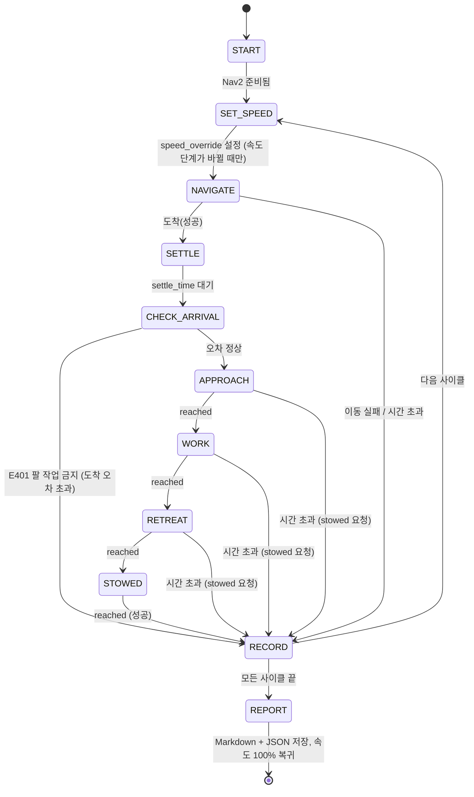

# MoMa 사이클 시운전 상태 흐름

`robot_field_toolkit/nodes/commissioning_runner.py`의 상태 머신입니다.
사이클 1회 = 작업 지점 하나 방문. 속도 오버라이드 30% → 60% → 100% 단계마다 N회(기본 3회).

- 팔 요청은 `/arm/pose_request` → safety_interlock → arm_controller (주행 중이면 E302로 거부)
- 사이클 중 `/field_toolkit/alarms`에서 raised된 알람 코드를 사이클 기록에 남김
